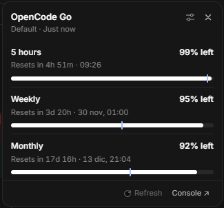

# opencode-desktop-go-usage

[](https://github.com/jtaraque/opencode-desktop-go-usage/actions/workflows/ci.yml)
[](LICENSE)

A small OpenCode Desktop plugin that shows your OpenCode Go allowance in the sidebar: the rolling 5-hour, weekly and monthly windows, what is left, when each one resets, and how your usage compares with the time left in the window.

<p align="center">
  
  <br>
  <sub>Screenshot from the English UI.</sub>
</p>

## Features

- A gauge pill you can place next to the update button, in the session header or in the sidebar header.
- A floating panel anchored to the pill. It may overlap the chat while open.
- 5-hour, weekly and monthly allowance with remaining percentage and reset countdown.
- A vertical marker for the time left in each window, plus a tooltip with the pace: `Under pace`, `On pace` or `Over pace`.
- Manual refresh with a one-minute cooldown and automatic refresh every 5 minutes while the panel is open. Opening the panel requests at most once per minute.
- Spanish, English, German, French, Portuguese (Brazil), Italian, Japanese and Simplified Chinese copy; light and dark themes.
- Read-only display: the plugin reads the local OpenCode server and opens the Console only when you ask it to.

The plugin follows the app language. The labels below use the English copy.

## Requirements

- OpenCode Desktop 2.4.x with GUI plugin support. Tested with 2.4.1.
- An OpenCode Go subscription connected to the workspace.
- Side tabs, top tabs and Inbox are supported. The sidebar-header placement needs a sidebar (side tabs or Inbox); the update-button placement works in all three layouts.
- Windows was tested; macOS and Linux are expected to work but have not been tested by the author.

## Installation

### From GitHub

```sh
git clone https://github.com/jtaraque/opencode-desktop-go-usage.git
cd opencode-desktop-go-usage
```

The repository includes the built `dist/gui-experimental.cjs`; no build step is needed to use it. Run `npm ci` only if you want to develop or rebuild the bundle.

Add the directory to the `plugins` array in `~/.config/opencode/opencode.json` (or `opencode.jsonc` on Windows) and preserve your existing entries:

```jsonc
{
  "plugins": [
    "C:/Users/you/opencode-desktop-go-usage"
  ]
}
```

Reload the window. The desktop app reads plugin entries from `opencode.json(c)`, not from `cli.json`. You can also check **Settings → Extensions → Plugins**.

### Uninstall

Remove the entry from `opencode.json(c)`, reload the window, and delete the clone if you no longer need it.

## Usage

1. Look for the gauge pill in the place you chose: next to the update button, in the session header or in the sidebar header.
2. Click it to open the panel. Header placements open downward; the update-button placement opens upward in side tabs and Inbox, and downward in top tabs.
3. Read each window: the bar shows the allowance left, the vertical line shows the time left, and the tooltip compares both.
4. Click the sliders button in the panel header to open **Position**. Pick one of the three placements; unavailable choices are disabled. The panel closes and the pill reappears in the new place with a short pulse so you can spot it.
5. Close the panel with the pill or the **X**. Clicking outside and pressing Escape do not close it.
6. Use **Refresh** to refresh immediately or **Console ↗** to open the usage page in the OpenCode Console. The refresh button is disabled for one minute after a request.

In top tabs, the sidebar-header placement is disabled. The update-button placement uses the end of the tab strip. In Inbox, all three placements are available.

In the sidebar footer the panel follows the sidebar width. In the header and sidebar-header placements it is a 320 px floating panel and may overlap the chat. On a narrow panel the rows wrap, the header summary hides and the footer buttons stack. All three reset lines hide together as soon as the longest one would wrap to a second line; the bar tooltip still shows each reset. If the available height above or below the pill is short, the panel scrolls instead of overflowing the viewport.

The five-hour window starts when you first use the allowance and lasts five hours. The weekly window resets on Monday at 00:00 UTC. The monthly window resets when a new paid period starts.

## How it works

The panel calls the local OpenCode server endpoint `GET /api/experimental/usage/limits` and renders:

- `percent`: the percentage already used in each window.
- `resetsAt`: the next reset, shown as a countdown and a local time.
- `workspace.usageURL`: the link used by **Console ↗**.

The remaining percentage is `100 - percent`. The time marker is calculated from `resetsAt` and the length of the window. For the monthly window, the start is inferred by subtracting one calendar month from `resetsAt`, so the marker can be off by about a day around month-end or billing-cycle changes.

The panel only requests data while it is open. Opening it again within a minute reuses the last result; while it stays open, the plugin refreshes every five minutes. The refresh button is disabled for one minute after every request. The header shows **Just now** for the first minute and then minutes, so it does not change every second.

## Compatibility

| OpenCode Desktop | Status |
| --- | --- |
| 2.4.x | Supported; tested with 2.4.1 |
| Other versions | Not tested |

| Layout | Placements |
| --- | --- |
| Side tabs | All three |
| Top tabs | Next to update and session header; sidebar header is disabled |
| Inbox | All three |

The GUI plugin API is experimental. A future OpenCode release may change it; check the releases page before updating if the pill stops loading.

## Troubleshooting

**The pill does not appear**

- Confirm the plugin is listed in **Settings → Extensions → Plugins**.
- Run `opencode plugin list` and check that the plugin is active.
- The sidebar-header placement needs a sidebar; in top tabs it is disabled. The update-button placement works in every layout.
- Reload the window.

**`opencode plugin add github:…` fails with `git dep preparation failed`**

Use the clone and `plugins` path method above. Some Windows CLI builds currently fail when installing Git packages directly.

**The panel says there is no Go subscription**

The workspace signed in to OpenCode does not report a Go allowance. Connect OpenCode Go in the Console and reload.

**The panel says it could not load usage**

The local server may be restarting or unreachable. Use **Retry**; if the problem persists, check the OpenCode logs.

**The panel is not aligned after resizing**

The panel follows the sidebar rectangle. Collapse and reopen the sidebar, or reopen the panel.

## Development

```sh
npm ci
npm run dev        # rebuild on change
npm run typecheck
npm run test
npm run check      # typecheck + tests + build
```

The built entry is `dist/gui-experimental.cjs`. A local plugin directory needs a `package.json` with a `name` and the `./gui-experimental` export; the desktop app reloads the GUI when the bundle changes.

Project layout:

```text
src/gui.tsx        window setup, pill, panel and data loading
src/usage.ts       window math, remaining percentage and pace
src/usage.test.ts  unit tests for the math
src/style.css      scoped plugin styles
docs/panel.png     screenshot used by this README
```

See [CONTRIBUTING.md](CONTRIBUTING.md) for the full contributor workflow.

## Roadmap

See [ROADMAP.md](ROADMAP.md). The next steps are configurable pill placement, more translations and the other desktop layouts.

## Author

[jtaraque](https://github.com/jtaraque)

## License

MIT © [jtaraque](https://github.com/jtaraque). See [LICENSE](LICENSE).

Security reports: see [SECURITY.md](SECURITY.md).
